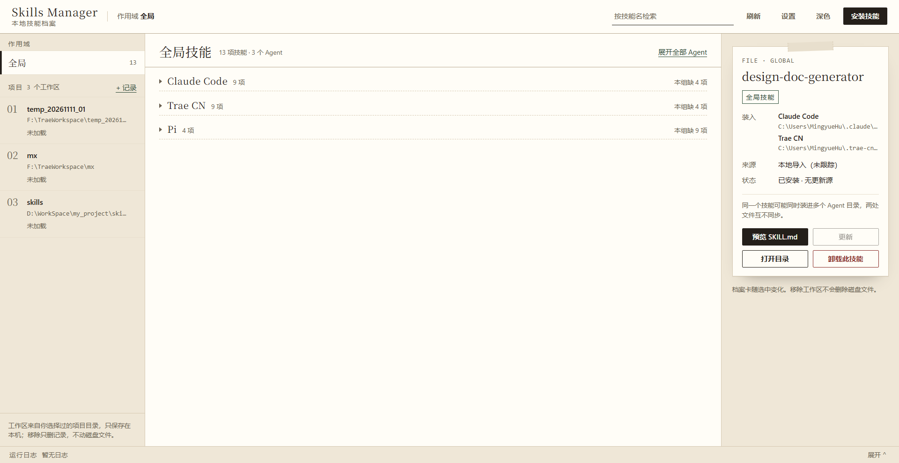
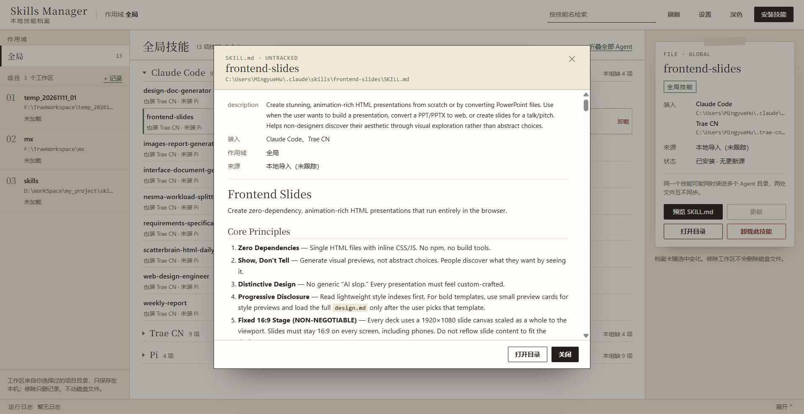
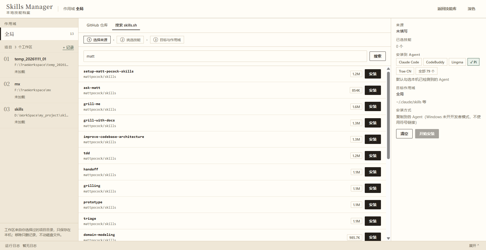

# Skills Manager

SKill Manager 是一个可视化桌面端Agent技能管理应用。 

技术栈：Electron 38 + electron-vite 2 + React 18 + Vite 5，Markdown 渲染使用 marked + DOMPurify，技能元信息解析使用 yaml。


## 下载地址

[https://github.com/humyue/skills-desktop/releases/latest](https://github.com/humyue/skills-desktop/releases/latest)

*当前只构建了windows端安装包，其他平台可以通过clone源码构建。*

## 运行界面

### 首页




### 技能预览



### 搜索安装技能



## 功能

- **两级作用域**：左侧固定「全局」与「项目」两个入口。
- **按 Agent 分组**：无论全局还是工作区，技能都按安装到的 Agent（Claude Code、Trae CN、Pi 等）分节展示
- **工作区管理**：记录选择过的项目目录，显示名称、路径与技能数；顺序按记录时间固定，切换不会置顶；目录缺失时标记「目录缺失」并禁止安装/卸载，移除只删记录、不动磁盘文件。
- **SKILL.md 预览**：档案卡点「预览 SKILL.md」，弹窗展示 frontmatter 与正文；多个 Agent 装了同一技能时，预览读取的是当前选中分组对应 Agent 目录下的文件。
- **安装技能**：
  - 「GitHub 仓库」页签：输入 `owner/repo` 或 GitHub 地址，先预览仓库内全部技能再勾选安装；
  - 「搜索 skills.sh」页签：在线搜索 [skills.sh](https://skills.sh) 并预览；
  - 目标 Agent 默认勾选本机检测到的，右侧同时显示当前作用域的目标路径；
  - 安装方式为复制到各 Agent 目录。
- **卸载与更新**：列表里每一行属于某个 Agent 分组，点该行的「卸载」只移除这个 Agent 目录下的副本，其他 Agent 里的同名技能不受影响（多个 Agent 共用同一目录时会一起移除，例如共享池 `.agents/skills`）；档案卡的「全部卸载」才会清理该技能的所有 Agent。有仓库来源（`tracked`）的技能可点「更新」从原仓库拉取最新版本（更新会作用于该技能的所有 Agent 副本），本地导入的技能没有更新源，按钮置灰。
- **Agent 检测**：判断依据是 Agent 自己的用户目录（如 `~/.claude`、`~/.pi`、`~/.trae-cn`），而不是共享技能池 `~/.agents/skills`，避免共用目录的 Agent 被误判为已安装。
- **设置**：运行环境检测（HTTP 连通性 / git 可用性 / CLI 就绪状态）、内置 CLI 版本与路径、浅色 / 深色主题切换。


## 快速开始

```powershell
# 1. 进入项目目录
cd skills-desktop

# 2. 安装依赖（国内网络建议加镜像）
$env:ELECTRON_MIRROR="https://npmmirror.com/mirrors/electron/"
npm install

# 3. 启动开发模式（自动打开应用窗口）
npm run dev
```

### 构建与打包

```powershell
npm run build   # 仅构建到 out/
npm run start   # 以生产模式预览构建结果
npm run dist    # 生成 Windows 安装包，输出到 release/
```


## 使用说明

1. **首次使用**：打开「设置」，点「检测网络与依赖」，确认 `HTTP 可达`、`git 可用`、`CLI 就绪` 三项均为正常。
   - 应用会自动沿用系统代理，若 `git` 检测失败，先确认系统代理已开启（浏览器能打开 github.com 不代表 git 能连）。
2. **记录工作区**：在左侧「项目」区域点「+ 记录」选择项目目录。首次安装时工作区列表是空的，只包含你之后主动选择的目录。
3. **查看技能**：点左侧「全局」或某个工作区，中间按 Agent 分组列出技能；点任意一条，右侧档案卡显示装入的 Agent、各自的真实路径、来源与状态。
4. **安装技能**：点右上角「安装技能」。
   - 「GitHub 仓库」页签：填入来源 → 预览技能 → 勾选要装的技能；
   - 「搜索 skills.sh」页签：输入关键词（至少 2 个字符）→ 点搜索结果预览；
   - 在右侧确认目标 Agent 与作用域后点「开始安装」。
5. **卸载 / 更新**：列表行右侧「卸载」只删除当前分组（Agent）下的副本；档案卡「全部卸载」删除该技能在所有 Agent 下的副本；「更新」仅对 `tracked` 技能可用。


